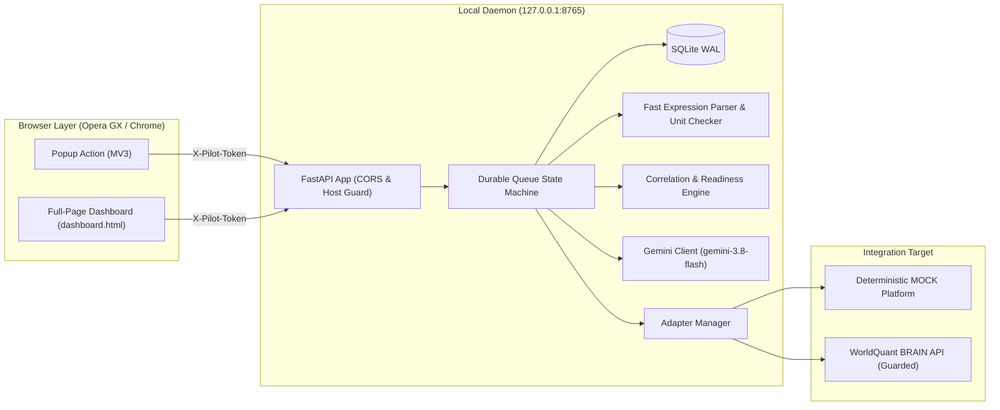

# Alpha Research Pilot: System Architecture

## 1. Overview & Monorepo Design

Alpha Research Pilot is organized as a local-first monorepo:
- `backend/`: Python 3.10+ / FastAPI backend owning the durable queue, SQLite database, Gemini API structured output generation, Fast Expression AST validator, and platform adapters.
- `extension/`: Manifest V3 browser extension and full-page standalone dashboard built with TypeScript, React, and Vite, supporting Opera GX and Google Chrome.
- `schemas/`: Shared data models and Pydantic schemas.
- `tests/`: Automated unit and integration test suite (AST parser, unit checks, profile limits, correlation logic, queue state machine, and 1,500-job software load test).
- `scripts/`: Operational scripts (`run_backend.sh`, `build_extension.sh`, `run_tests.sh`, `dry_run_demo.py`).
- `docs/`: Comprehensive technical, security, capability, and testing documentation.



## 2. Fast Expression AST Parser & Unit Validator

Unlike regex or heuristics, Alpha Research Pilot uses a real recursive-descent lexer and parser for the WorldQuant BRAIN Fast Expression language subset:
1. **Multi-Statement Grammar**: Parses statements separated by semicolons (`ident = expr;`).
2. **Defined-Before-Use Checking**: Traverses symbol tables statement by statement; undeclared variables trigger validation failure.
3. **Allowlist Enforcement**:
   - Confirmed Fields: `open`, `high`, `low`, `close`, `volume`, `returns`, `adv20`, `vwap`, `cap`, `assets`, `sales`, `ebitda`, `ebit`, `capex`, `enterprise_value`, `operating_income`, `cashflow_op`, `retained_earnings`, `scl12_buzz`, `implied_volatility_call_120`, `implied_volatility_put_120`, `nws12_afterhsz_sl`.
   - Vector Reduction: `nws12_afterhsz_sl` MUST be enclosed in vector reduction functions (e.g. `vec_avg(nws12_afterhsz_sl)`).
   - Forbidden Fields: `scl15_sentiment`, `fam_est_eps_rank` (blocked by default).
   - Confirmed Functions: `rank`, `group_rank`, `group_zscore`, `group_neutralize`, `winsorize`, `ts_backfill`, `ts_rank`, `ts_mean`, `ts_delta`, `ts_delay`, `ts_sum`, `ts_corr`, `ts_std_dev`, `ts_decay_linear`, `signed_power`, `trade_when`, `vec_avg`, `add`.
   - Forbidden Operators: `regression_neut`, `ts_max` (blocked by default).
4. **Unit Checker**:
   - Distinguishes currency, shares, ratios, and dimensionless variables.
   - Rejects constants added to unit-bearing terms (e.g., `volume * close + 1`, `cashflow_op + 0.000001`).
   - Supports price-range denominator pattern: `high - low + 0.001 * close`.
5. **Exact & Normalized Duplicate Detection**: Generates canonical AST whitespace-stripped representations and SHA-256 hashes to guarantee no duplicates are submitted.

## 3. Durable Queue State Machine

The candidate lifecycle transitions strictly through:
```
generated -> validation_failed -> ready -> reserved -> submitting -> submission_uncertain -> running -> completed -> failed -> cancelled
```
- **Atomic Budget Reservation**: Budget is reserved transactionally before dispatch (`UPDATE campaigns SET submitted_simulations_count = submitted_simulations_count + 1 WHERE id = ? AND submitted_simulations_count < budget_simulations`).
- **Crash Recovery**: Stuck `submitting` items are transitioned to `submission_uncertain` for reconciliation; `reserved` items are restored to `ready`.
- **Survives Popup Close**: The entire campaign loop runs within the Python daemon, surviving browser popup closure.

## 4. Mandatory Self-Correlation & Moving Cutoff Control

- **Reference Library**: Initialized with user-submitted alphas S1 through S7.
- **Platform Self-Correlation**: Evaluates candidate correlation against reference alphas; status is tracked distinctly (`NOT CHECKED`, `LOCAL ESTIMATE ONLY`, `PLATFORM VERIFIED PASS`, `PLATFORM VERIFIED FAIL`, `STALE / RECHECK REQUIRED`).
- **Missing Check Rule**: A missing correlation check is **NEVER** marked as PASS.
- **Dynamic Sub-Universe Cutoff**: Models main Sharpe, sub-universe Sharpe, and the moving sub-universe cutoff returned by the platform.
